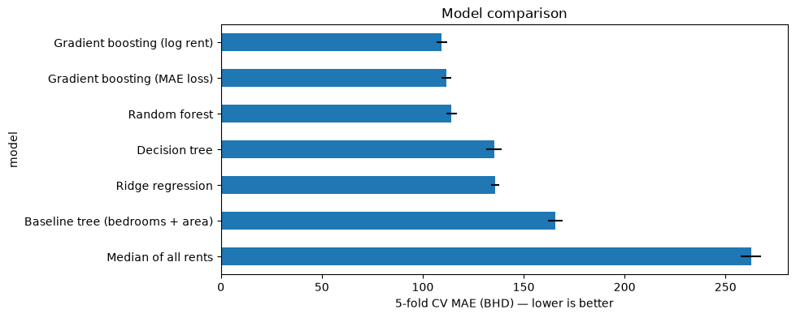
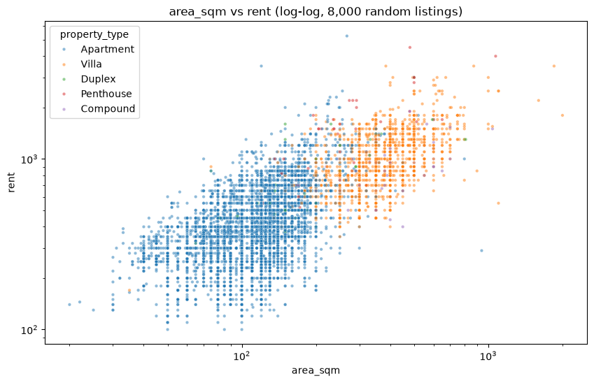
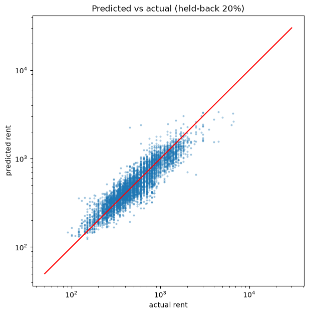

# Bahrain Rent Prediction

Predicting the monthly rent (BHD) of residential listings in Bahrain from their size, type, location and listing details.

This is **Project 3** of the General Assembly Data Science Bootcamp (DSB-PT4, Bahrain 2026), run as a private class Kaggle competition. The metric is **MAE** (mean absolute error, in BHD), so lower is better.

## Results

| Model | 5-fold CV MAE | Held-back 20% | Kaggle public |
|---|---|---|---|
| Predict the median for everything | 262.6 | – | – |
| Baseline decision tree (bedrooms + area) | 165.6 | – | 156.77 |
| Stacking ensemble (bedrooms + area) | – | 158.6 | 154.04 |
| Ridge regression | 135.8 | – | – |
| Random forest | 114.3 | – | – |
| **Gradient boosting on log(rent), full pipeline** | **109.5** | **104.9** | **102.27** |

The final model is **58% better than predicting the median** and **34% better than the 2-feature baseline**. Most of the gain came from cleaning the data and building better features, not from a fancier model: stacking on the same 2 features only improved the score by about 3 BHD.



## The data

- **Train:** 32,090 listings × 41 columns. **Test:** 3,566 listings, rent hidden.
- The listings came from **3 different scrapes** of Bahraini property sites, each with its own formats and columns.
- The data isn't included in this repo because the competition rules don't allow sharing it. See [Data/README.md](Data/README.md).

## Approach

1. **Cleaning** (train only; test rows are never deleted)
   - Parsed mixed formats: `"1,399 sqft / 130 sqm"` → 130, `"3+ Maid"` → 3 bedrooms + `has_maid_room`, `studio` → 0.
   - Removed listings scraped twice (566 rows) and "rents" of 30,000 BHD or more, which were actually sale prices.
   - Treated 1-sqm sizes as missing values (they were placeholders), and merged neighbourhood columns across the scrapes.
2. **EDA:** each feature on its own and against rent, always compared within the same property type so villas don't skew the results.
3. **Feature engineering:** `amenities_count`, rare property types grouped as `Others`, and 7 keyword flags from the title and description (private pool, sea view, beach, luxury, brand new, freehold, staff accommodation).
4. **Modelling:** a scikit-learn `ColumnTransformer` + `Pipeline` with median imputation and missing-value indicators for numeric features, one-hot encoding for categorical ones, and 7 models compared with 5-fold cross-validation.
5. **Final model:** `HistGradientBoostingRegressor` trained on log(1 + rent), retrained on all the training data before predicting the test set.

## Key findings

**What drives rent in Bahrain:**
1. Size: area, bedrooms and bathrooms.
2. Property type: villas rent for about 2.4× as much as apartments.
3. Neighbourhood: coastal and island developments are the most expensive, about 7–9× the cheapest areas.
4. Furnishing, a maid room, and premium keywords (private pool, sea view, freehold).



**Where the model struggles:** it is most accurate for apartments (MAE about 74 BHD) and least accurate for rare, expensive types such as whole buildings, penthouses and villas, which have fewer examples and much more varied rents.



## Repository structure

```
├── Notebook/
│   ├── main.ipynb          # full EDA, every cleaning decision, model comparison, submission
│   ├── Best_Model.ipynb    # clean version of the final model only
│   ├── Baseline.ipynb      # first attempt: pruned decision tree on 2 features
│   └── Ensembling.ipynb    # second attempt: stacking ensemble on 2 features
├── Submissions/            # Kaggle submission files (Property_id, predicted rent)
├── images/                 # charts used in this README
├── Data/                   # put the Kaggle CSVs here (not tracked by git)
└── requirements.txt
```

**Start with [`Best_Model.ipynb`](Notebook/Best_Model.ipynb)** for the final model, or [`main.ipynb`](Notebook/main.ipynb) for the full analysis.

## How to run

```bash
pip install -r requirements.txt
```

1. Download `property_data.csv` and `test.csv` from the competition into `Data/` (see [Data/README.md](Data/README.md)).
2. Open the notebooks in `Notebook/` and run them top to bottom.

## Next steps

- Pull the number of units for whole buildings out of the listing text (e.g. "18 flats").
- Fill missing coordinates (only about 45% of listings have them) with average coordinates per neighbourhood.
- Tune the pipeline with `GridSearchCV` and try stacking the full-feature models.

## Tools

Python · pandas · NumPy · scikit-learn · matplotlib · seaborn · Jupyter

---

**Author:** Bahaa AlFardan · [GitHub](https://github.com/bahaaalf404)
